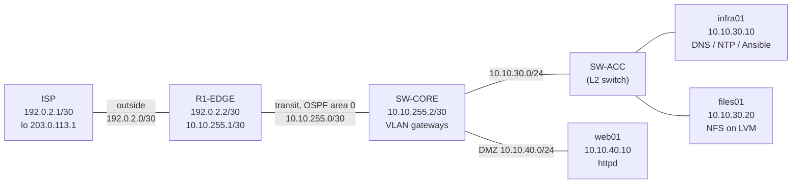

[README.md](https://github.com/user-attachments/files/33465238/README.md)
# Enterprise-Network-Linux-Infrastructure-Lab

A small enterprise network and Linux infrastructure built end to end in GNS3 and VMware Workstation. The network half covers addressing, inter-VLAN routing, OSPF, and NAT. The systems half covers DNS, NTP, a web server, NFS on LVM, firewalld, SELinux, and an Ansible baseline.

**Skills demonstrated:** CCNA-level routing and NAT, RHCE/RHCSA-level service administration, troubleshooting across virtualization, routing, and OS layers, and configuration management with Ansible.

---

## Contents

- [Architecture](#architecture)
- [IP plan](#ip-plan)
- [Tools and versions](#tools-and-versions)
- [Network build](#network-build)
- [Server build](#server-build)
- [Ansible baseline](#ansible-baseline)
- [Verification](#verification)
- [Troubleshooting log](#troubleshooting-log)
- [What I would do next](#what-i-would-do-next)

---

## Architecture



**Design summary**

- **ISP** simulates the upstream provider with a public test loopback.
- **R1-EDGE** is the edge router. It runs source NAT for the whole lab and a static destination NAT that publishes web01 on a public test address.
- **SW-CORE** is a VyOS router acting as the core. It holds the gateways for the management, user, server, and DMZ subnets and advertises them to R1-EDGE over OSPF.
- **SW-ACC** is an access switch connecting the servers to the core.
- **infra01, files01, and web01** are RHEL 9 virtual machines running the services described below.

OSPF runs only on the transit link between R1-EDGE and SW-CORE. The outside link stays out of OSPF, and the server-facing interfaces are advertised as passive so no OSPF hellos reach the hosts.

---

## IP plan

| Network | CIDR | Gateway / notes |
| --- | --- | --- |
| Outside (ISP to R1-EDGE) | 192.0.2.0/30 | ISP .1, R1-EDGE .2 |
| Transit (R1-EDGE to SW-CORE) | 10.10.255.0/30 | R1-EDGE .1, SW-CORE .2 |
| VLAN 10 MGMT | 10.10.10.0/24 | 10.10.10.1 on SW-CORE |
| VLAN 20 USERS | 10.10.20.0/24 | 10.10.20.1 on SW-CORE |
| VLAN 30 SERVERS | 10.10.30.0/24 | 10.10.30.1 on SW-CORE |
| VLAN 40 DMZ | 10.10.40.0/24 | 10.10.40.1 on SW-CORE |
| ISP loopback | 203.0.113.1/32 | Public test address |
| NAT public address for web01 | 192.0.2.10/32 | Static destination NAT on R1-EDGE |

| Host | Address | Role |
| --- | --- | --- |
| infra01 | 10.10.30.10 | DNS (BIND), NTP (chrony), Ansible control node |
| files01 | 10.10.30.20 | NFS export on LVM |
| web01 | 10.10.40.10 | httpd, the only host reachable inbound through NAT |

---

## Tools and versions

| Component | Details |
| --- | --- |
| Hypervisor | VMware Workstation on Windows |
| Network emulation | GNS3 2.2.61 with the GNS3 VM |
| Routers | VyOS (rolling release) |
| Servers | Red Hat Enterprise Linux 9 |
| Automation | ansible-core |

**Why VyOS instead of Cisco IOS:** IOSv images are licensed for Cisco Modeling Labs only, so I used VyOS, which supports OSPF, NAT, DHCP, and a stateful firewall. The design and acceptance tests are the same.

### Port naming offset

On this VyOS template, GNS3's link menu is one lower than the interface name inside VyOS. Draw cables by the GNS3 label and configure addresses by the VyOS name.

| GNS3 link menu | VyOS interface |
| --- | --- |
| eth0 | eth1 |
| eth1 | eth2 |
| eth2 | eth3 |
| eth3 | eth4 |

---

## Network build

### ISP

```
set interfaces ethernet eth1 address '192.0.2.1/30'
set interfaces ethernet eth1 description 'TO-R1-EDGE'
set interfaces loopback lo address '203.0.113.1/32'
set protocols static route 10.0.0.0/8 next-hop 192.0.2.2
set protocols static route 192.0.2.10/32 next-hop 192.0.2.2
```

### R1-EDGE

```
set interfaces ethernet eth1 address '192.0.2.2/30'
set interfaces ethernet eth1 description 'OUTSIDE'
set interfaces ethernet eth2 address '10.10.255.1/30'
set interfaces ethernet eth2 description 'TO-SW-CORE'
set protocols static route 0.0.0.0/0 next-hop 192.0.2.1

set protocols ospf interface eth2 area '0'
set protocols ospf interface eth2 network 'point-to-point'
set protocols ospf parameters router-id '1.1.1.1'
set protocols ospf default-information originate always

set nat source rule 100 outbound-interface name 'eth1'
set nat source rule 100 source address '10.10.0.0/16'
set nat source rule 100 translation address 'masquerade'
set nat destination rule 10 inbound-interface name 'eth1'
set nat destination rule 10 destination address '192.0.2.10'
set nat destination rule 10 translation address '10.10.40.10'
```

### SW-CORE

```
set interfaces ethernet eth1 address '10.10.255.2/30'
set interfaces ethernet eth1 description 'TO-R1-EDGE'
set protocols ospf interface eth1 area '0'
set protocols ospf interface eth1 network 'point-to-point'
set protocols ospf parameters router-id '2.2.2.2'

set interfaces ethernet eth2 description 'TRUNK'
set interfaces ethernet eth2 vif 10 address '10.10.10.1/24'
set interfaces ethernet eth2 vif 20 address '10.10.20.1/24'
set protocols ospf interface eth2.10 area '0'
set protocols ospf interface eth2.10 passive
set protocols ospf interface eth2.20 area '0'
set protocols ospf interface eth2.20 passive

set interfaces ethernet eth3 address '10.10.30.1/24'
set interfaces ethernet eth3 description 'SERVERS'
set protocols ospf interface eth3 area '0'
set protocols ospf interface eth3 passive

set interfaces ethernet eth4 address '10.10.40.1/24'
set interfaces ethernet eth4 description 'DMZ'
set protocols ospf interface eth4 area '0'
set protocols ospf interface eth4 passive
```

The management and user gateways are configured as 802.1Q subinterfaces on the trunk port, ready for tagged hosts. The server and DMZ gateways sit on dedicated routed interfaces.

---

## Server build

All three guests use a static address on the lab NIC with the gateway pointing at SW-CORE and DNS pointing at infra01. Example for infra01:

```bash
nmcli con add type ethernet ifname ens36 con-name ens36 \
  ipv4.addresses 10.10.30.10/24 ipv4.gateway 10.10.30.1 \
  ipv4.dns 10.10.30.10 ipv4.method manual connection.autoconnect yes
nmcli con up ens36
```

### DNS on infra01 (BIND)

Authoritative server for `northwind.lab`, recursion disabled, queries limited to the lab range.

```
options {
    listen-on port 53 { 127.0.0.1; 10.10.30.10; };
    listen-on-v6 { none; };
    directory "/var/named";
    allow-query { localhost; 10.10.0.0/16; };
    recursion no;
    dnssec-validation no;
};

zone "northwind.lab" IN {
    type master;
    file "northwind.lab.zone";
    allow-update { none; };
};
```

Zone file `/var/named/northwind.lab.zone`:

```
$TTL 3600
@       IN SOA  infra01.northwind.lab. admin.northwind.lab. (
                2026101001 3600 900 604800 3600 )
        IN NS   infra01.northwind.lab.
infra01 IN A    10.10.30.10
files01 IN A    10.10.30.20
web01   IN A    10.10.40.10
r1-edge IN A    10.10.255.1
sw-core IN A    10.10.255.2
isp     IN A    192.0.2.1
```

Validated with `named-checkconf` and `named-checkzone`, then `systemctl enable --now named`.

### NTP on infra01 (chrony)

infra01 serves time to the lab from its local clock (stratum 10) because the lab has no internet. The default pool entry is commented out.

```
local stratum 10
allow 10.10.0.0/16
```

web01 and files01 use `server 10.10.30.10 iburst`.

### Web on web01 (httpd)

httpd serves a test page, `firewalld` allows the `http` service, and SELinux stays in enforcing mode. The default `httpd_sys_content_t` context on `/var/www/html` is correct.

### NFS on files01 (LVM)

A second 20 GB disk was added to files01. A 10 GB logical volume holds the export.

```bash
pvcreate /dev/sdb
vgcreate vg_data /dev/sdb
lvcreate -n lv_export -L 10G vg_data
mkfs.xfs /dev/vg_data/lv_export
mkdir -p /srv/export
echo '/dev/vg_data/lv_export /srv/export xfs defaults 0 0' >> /etc/fstab
mount -a

echo '/srv/export 10.10.30.0/24(rw,sync,no_root_squash)' > /etc/exports
exportfs -ra
semanage fcontext -a -t nfs_t '/srv/export(/.*)?'
restorecon -Rv /srv/export
systemctl enable --now nfs-server
```

The firewall allows `nfs`, `mountd`, and `rpc-bind`. SELinux is enforcing and the export directory has the `nfs_t` context.

### Package source

The guests have no internet and no Red Hat subscription, so packages came from the RHEL 9 DVD ISO used as a local repository.

```
[dvd-baseos]
name=DVD BaseOS
baseurl=file:///mnt/dvd/BaseOS
gpgcheck=0
enabled=1

[dvd-appstream]
name=DVD AppStream
baseurl=file:///mnt/dvd/AppStream
gpgcheck=0
enabled=1
```

---

## Ansible baseline

infra01 is the control node. An SSH key for the `admin` user is distributed to all three hosts, and `site.yml` applies the baseline.

<details>
<summary>inventory.ini and site.yml</summary>

```ini
[lab]
infra01 ansible_host=10.10.30.10
files01 ansible_host=10.10.30.20
web01   ansible_host=10.10.40.10

[lab:vars]
ansible_user=admin
```

```yaml
---
- name: Northwind baseline
  hosts: lab
  become: true
  tasks:
    - name: Set hostname
      ansible.builtin.hostname:
        name: "{{ inventory_hostname }}.northwind.lab"

    - name: Enable and start firewalld
      ansible.builtin.systemd:
        name: firewalld
        enabled: true
        state: started

    - name: Read SELinux mode
      ansible.builtin.command: getenforce
      register: selinux_mode
      changed_when: false

    - name: Confirm SELinux is enforcing
      ansible.builtin.assert:
        that: selinux_mode.stdout == 'Enforcing'
        fail_msg: "SELinux is {{ selinux_mode.stdout }}, expected Enforcing"

    - name: Install chrony
      ansible.builtin.dnf:
        name: chrony
        state: present

    - name: Point chrony at infra01
      ansible.builtin.lineinfile:
        path: /etc/chrony.conf
        regexp: '^server 10\.10\.30\.10'
        line: 'server 10.10.30.10 iburst'
      when: inventory_hostname != 'infra01'
      notify: Restart chronyd

    - name: Enable and start chronyd
      ansible.builtin.systemd:
        name: chronyd
        enabled: true
        state: started

  handlers:
    - name: Restart chronyd
      ansible.builtin.systemd:
        name: chronyd
        state: restarted
```

</details>

Design notes:

- Only built-in modules are used, so the playbook runs without extra collections or internet access.
- infra01 is the time source, so the chrony `server` line is skipped on it. That is why the recap shows one skipped task on infra01.
- The playbook completes with no failed hosts, and a second run reports `changed=0` on every host, confirming it is idempotent.

---

## Verification

Every item below was tested and passed.

| Test | Expected result |
| --- | --- |
| R1-EDGE `eth1` and `eth2` | Both `u/u` |
| `ping 192.0.2.1` and `ping 10.10.255.2` from R1-EDGE | Replies |
| `show ip ospf neighbor` | Neighbor in Full state |
| `show ip route` on R1-EDGE | The four 10.10.x.0/24 networks learned by OSPF |
| infra01 pings `10.10.30.1` and `10.10.255.1` | Replies |
| `dig @10.10.30.10 web01.northwind.lab` | `10.10.40.10` |
| `chronyc sources` on web01 | Lists `10.10.30.10` |
| `curl http://10.10.40.10/` from infra01 | Returns the Northwind page |
| NFS mount on infra01, then create a file | File created on the export |
| `ping 203.0.113.1` from the lab | Replies, translation visible in `show nat source translations` |
| ISP reaches `192.0.2.10` | Lands on web01 through destination NAT |
| `ansible-playbook site.yml`, run twice | No failures; second run reports no changes |

<!-- Add screenshots here: GNS3 topology, show ip ospf neighbor, show ip route, dig output, curl output, ansible PLAY RECAP -->

---

## Troubleshooting log

These are the problems I hit and how I resolved them.

**1. "No vmnet interface available between vmnet2 and vmnet19"**
GNS3 attaches each cabled VMware adapter to a free VMnet and found none. On GNS3 2.2.61 for Windows, the GNS3 VMware preferences have no VMnet list to edit. The VMnets must exist in the VMware Virtual Network Editor (VMnet2 and up, host-only, DHCP off), and the **"Connect a host virtual adapter to this network"** option must be **enabled**. GNS3 discovers VMnets through those host adapters, so unchecking the option made them invisible. After fixing the Virtual Network Editor and fully restarting GNS3, the VMware nodes started.

**2. Wrong GNS3 port on the core switch**
A cable drawn to GNS3 `eth1` arrives on VyOS `eth2`. The server link was on the trunk interface, so `eth3` stayed `u/d`. Redrawing the cable to GNS3 `eth2` (VyOS `eth3`) brought it up. This is the port naming offset described above.

**3. OSPF not advertising a passive interface**
On this VyOS version, `passive` alone does not enable OSPF on an interface. Without `set protocols ospf interface <name> area '0'`, the subnet was never advertised, R1-EDGE had no return route, and the servers could ping their gateway but not the edge router. Setting the area on every interface, including passive ones, fixed it. Mixing a per-interface `area` with an `area ... network` statement is rejected in this VyOS version.

**4. Lost configuration after deleting a node**
Deleting a VyOS node in GNS3 also deletes its configuration, because the config lives on the node's disk. I rebuilt SW-CORE from the documented config. Saving after every change (`commit` and `save`) and keeping the config in version control would have made this a copy and paste.

**5. Adding adapters to a running design**
Changing the adapter count on a node forces its links to be redrawn. Setting the adapter count on the template before dragging nodes avoids this.

**6. RHEL packages with no subscription or internet**
`dnf` failed with "no enabled repositories". The fix was a local repository from the RHEL DVD ISO. The first attempt failed with curl error 3 because the repo path had two slashes. Local paths need `file:///` (three slashes). Curl error 37 later meant the DVD was no longer mounted after a reboot. The Easy Install `autoinst.iso` also occupied the first optical drive, so the real DVD was on the second device. Identifying the device by size, not by name, solved that.

**7. `sudo` missing for the admin user**
The admin account was created without the `wheel` group, so sudo was refused. `usermod -aG wheel admin` on each guest fixed it before the Ansible phase.

**8. New VM did not boot**
A freshly added VM showed "operating system not found" because the GNS3 node pointed at an empty VM instead of the installed one. Pointing the template back at the original `.vmx` fixed it.

**9. BIND returned REFUSED**
`named` was running but the zone had not loaded, so it refused queries for a zone it was not authoritative for. Fixing the config error and reloading the zone changed the answer to `NOERROR` with the authoritative flag set. A related syntax error (`missing ';' before '}'`) came from a missing semicolon in `named.conf`, and `named-checkconf` pointed to the line.

---

## What I would do next

- Replace the unmanaged access switch with a managed switch and run all four VLANs as 802.1Q tagged traffic on a trunk.
- Add VyOS firewall rules between the DMZ and the server subnet to enforce least privilege.
- Add DHCP on the user VLAN with a relay, and a client to test it.
- Store router configs in version control so a lost node can be rebuilt from the repository.
- Add monitoring and centralized logging.
